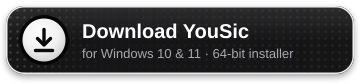

# YouSic

A music player for Windows (Electron).

<p align="center">
  <a href="https://github.com/SakshamSaxena0-0/YOU-SIC/releases/latest/download/YouSic-Setup.exe"></a>
  <br>
  <sub>Latest version · <a href="https://github.com/SakshamSaxena0-0/YOU-SIC/releases">all releases</a></sub>
</p>

## Install

1. Download **`YouSic-Setup.exe`** with the button above (Windows 10 or 11, 64-bit).
2. Run it. The app isn't code-signed, so Windows may show *Windows protected your PC*: choose *More info*, then
   *Run anyway*.
3. Pick a folder (or keep the default). The installer adds Start menu and desktop shortcuts, and YouSic can be
   removed from *Settings → Apps* like any other app.

## Build from source

- **Run:** `npm install`, then `npm start`
- **Build the exe:** `npm run dist` (folder build: `dist\win-unpacked\YouSic.exe`) or `npm run installer`
  (`dist\YouSic-Setup.exe`)

On first start the app scans your Windows *Music* folder. Add more folders from Library → *Add folder*, or from Settings.

## Features

| Area | What it does |
| --- | --- |
| Window layout | Wide windows (980 px and up) have three columns: the library (or the equalizer) on the left, in a Windows 11-style navigation pane (a rail with ☰, Library, Equalizer and Settings; ☰ folds the panel down to the rail, and it folds by itself below 1200 px; the library's root is a list of rows with counts), the player in the middle (the album art fills the whole column, edge to edge, with the title and controls over its lower part on a dark fade; tap it for the song info). *Admire art* (the picture button in the title bar, or A) hides the header and the controls to show only the art; A, Esc or a tap on the cover brings them back, and lyrics or the visualization on the right. The right-hand panel switches with its Lyrics / Visualizer tabs, the dock buttons or Y / V, and hides with its arrow button (the player then takes the room; LYRICS or WAVE brings it back). Narrow windows show one screen at a time. |
| Player | Blurred, slowly drifting album-art background; accent color extracted from the cover; 3D album-art carousel |
| Gestures | Album art: swipe ←/→ to change track, swipe ↓ (or click) for the track's category, swipe ↑ for lyrics. Mini-player: click to open the player, drag ←/→ to change track, long-press to open the playing category. Library: swipe → from the left edge (or Alt+drag, mouse Back, Backspace) for the parent category. Visualization: swipe ←/→ to change presets |
| Seekbar | Real waveform, decoded from the file and morphed in; the time under the pointer and its bar lit on hover, a bubble while dragging; mouse wheel seeks |
| Library | Folders, Folders Hierarchy, All Songs, Albums, Artists, Album Artists, Genres, Years, Composers, Playlists, Queue, Recently Added/Played, Most Played, Top Rated; search; sort options; list or grid view (the list menu, ⋮ beside search: *View > List view / Grid view*, remembered per kind of view; grid view shows a list's folders, artists... and songs as tiles like the library's own); Ctrl+wheel zoom; virtualized lists and grids; in the Brutal mood, a dot-matrix spotlight follows the mouse over the tiles and lights the rims near it |
| Playback | Gapless (next track preloaded) or crossfade (1–12 s); shuffle; repeat off/category/song; Play Next / Queue; resumes the last session |
| Equalizer | 10-band graphic EQ with a live frequency-response curve, 21 presets plus your own; Preamp, Bass, Treble, Balance and Tempo knobs; Limiter; Reverb tab with 7 knobs and 8 presets |
| Visualization | MilkDrop presets (butterchurn) in the right-hand panel (over the album art in narrow windows) or fullscreen; shuffle / locked / sequential preset modes |
| Lyrics | Synced `.lrc` files next to the song, plus embedded (synced or plain) lyrics tags; click a line to seek |
| Windows | Custom title bar (with the song menu, mini player, full screen and admire art beside the window buttons), Ctrl+, opens Settings, media keys and the Windows media flyout (SMTC), taskbar thumbnail prev/play/next buttons, sleep timer with fade-out, star ratings, track info |

Supported formats: MP3, FLAC, M4A/AAC, OGG/Opus, WAV, WebM.

## Android

`dist-android/YouSic.apk` is the same player for Android phones and tablets (Android 8.0 or newer). The interface is the
same code as the Windows app (`renderer/`), running in a WebView; a small native layer (`android/src`) takes the place of
`main.js`:

- **Music:** found through Android's media library, all storage by default. *Add Folder* opens Android's folder picker to
  narrow it down. Covers come from the songs' embedded art (or Android's thumbnails), lyrics from `.lrc` files or the tags.
- **Playing in the background:** a media notification with lock-screen and headset controls. Music keeps playing with the
  screen off and after the app is closed from the recent apps; it pauses for calls and when headphones are unplugged.
- **What differs:** no window background setting (no desktop wallpaper or acrylic on a phone), no keyboard shortcuts, no
  *Show in Explorer*. Android's back button steps back through the app. Reading `.lrc` files needs *All files access*,
  which the lyrics panel offers when it finds none.

**Install:** copy the APK to the phone and open it (allow installing from that app when Android asks).
**Build:** `npm run android` (needs the Android SDK: build-tools 35, platform 34, and a JDK; see `android/build.js`). The
first build creates the signing key `android/yousic.keystore` (not in git). Keep it: updates must be signed with the
same key to install over the app.

## Shortcuts

Space play/pause · Ctrl+←/→ prev/next · ←/→ seek 5 s (Shift: 30 s) · ↑/↓ volume · M mute · E equalizer ·
V visualization (F fullscreen) · Y lyrics · A admire art (wide windows) · S shuffle · R repeat · Ctrl+F search · Backspace back · Alt+0…5 rate

## Layout

```
main.js          main process: app:// protocol (range-streamed audio, covers), library scan, lyrics, storage
preload.js       IPC bridge
renderer/
  index.html     app shell
  css/app.css    theme, layout, animations
  css/spotlight.css, js/spotlight.js   the library tiles' cursor spotlight (Brutal mood)
  css/fluent.css   the desktop layout: navigation rail and list, title bar tools, floating panes, pane morphs
  js/audio.js    Web Audio engine (2 decks, EQ / tone / balance / reverb / limiter)
  js/player.js   queue, shuffle/repeat, gapless & crossfade
  js/*View.js    player, library, equalizer, visualization, lyrics screens
```

User data (library cache, covers, settings, playlists, stats) lives in `%APPDATA%\YouSic`.

## License

MIT, see [LICENSE](LICENSE).
